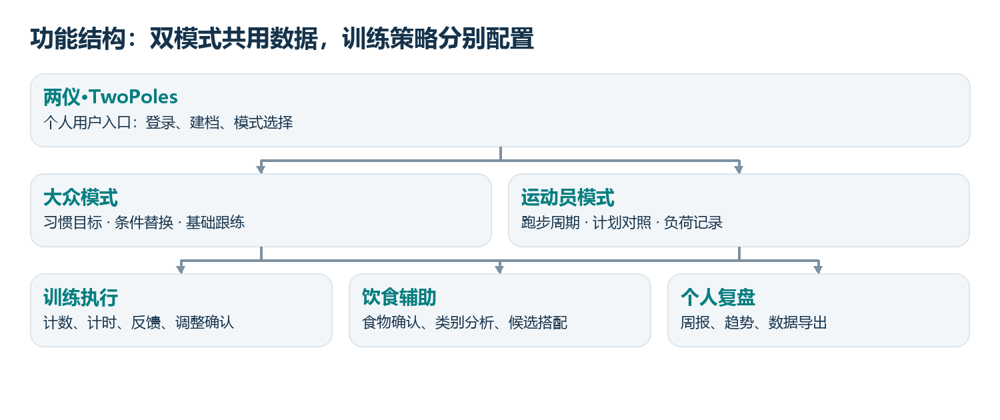
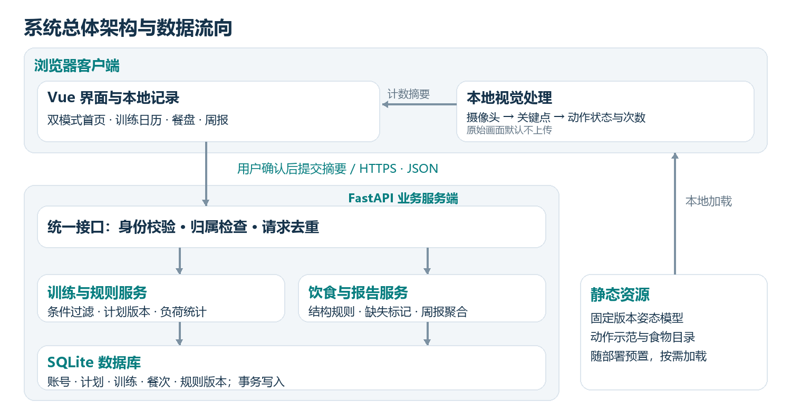
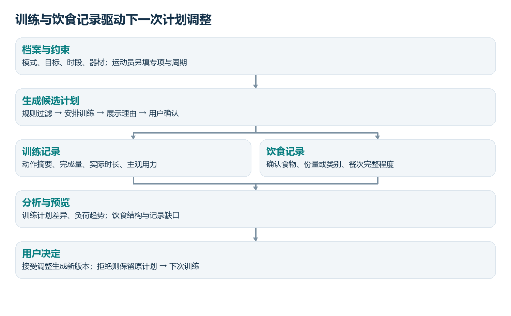
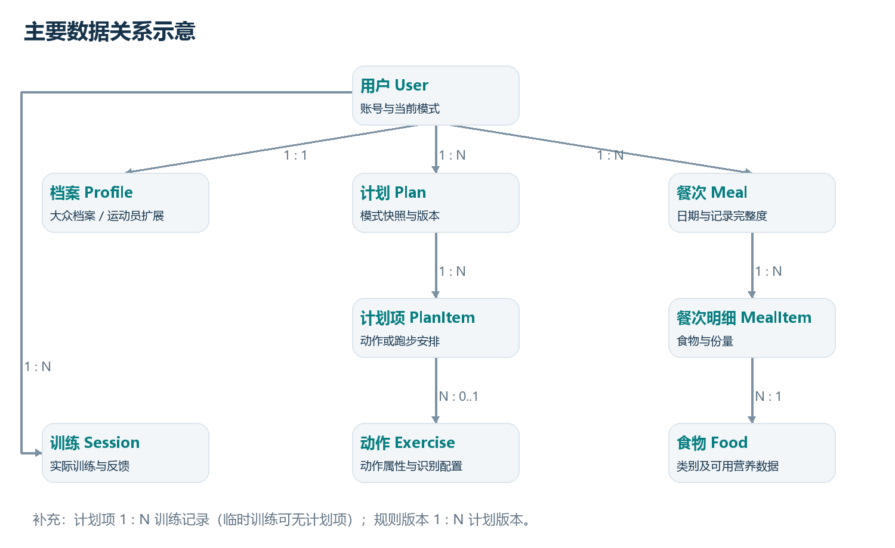
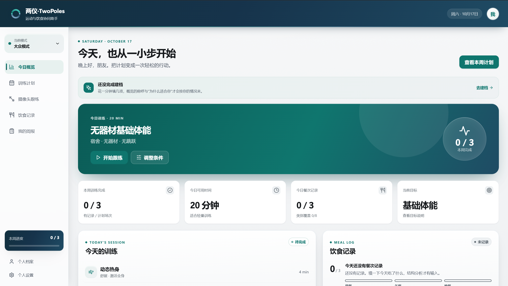
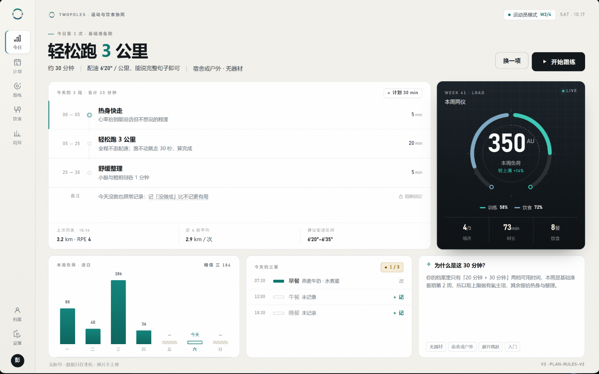
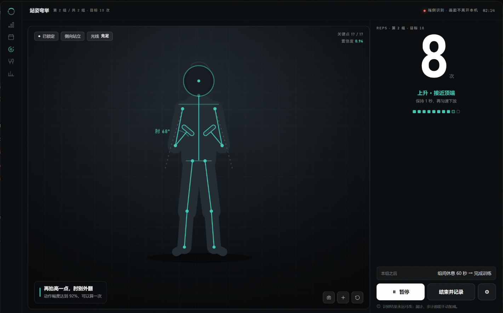
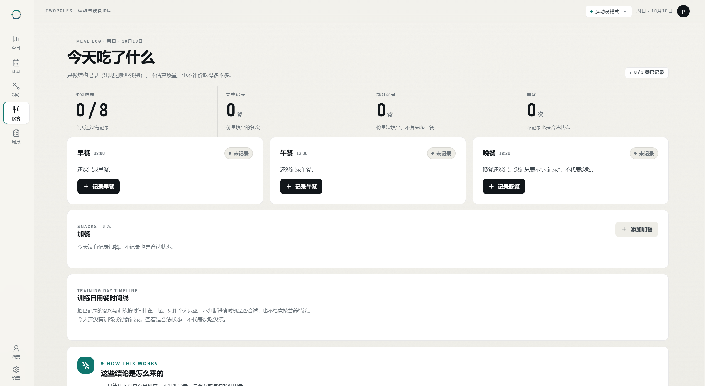
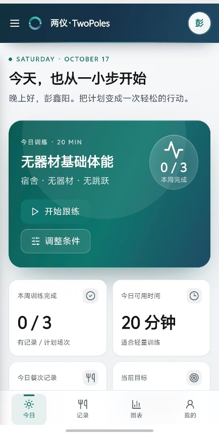

# 《程序设计综合实验》项目需求分析与概要设计文档

程序设计综合实验 · 双模式运动与饮食辅助系统

> 项目名称：两仪·TwoPoles（个性化运动与饮食协同助手）
>
> 组员1：________（学号：________）
> 组员2：________（学号：________）
> 组员3：________（学号：________）
>
> 完成日期：2026年10月17日

> 说明：仓库内的本文档不带姓名与学号。交付用的 docx 由 `artifacts/fitness-design/build_document.py` 生成，真名从同目录的 `members.json`（已 gitignore）注入；需要提交纸质或电子版时，用生成后的 docx，不要把手填名字的版本提交回仓库。

---

## 1. 项目概述

### 1.1 项目背景与简介

大众健身用户常面临训练动作选择困难、计划与实际时间不符、饮食记录难以转化为具体反馈等问题；具有训练基础的运动员则需要围绕专项和周期整理训练安排、比较计划与实际完成情况，并持续观察个人训练记录。两类用户的目标与信息需求不同，统一的功能入口和反馈方式难以同时满足其使用习惯。

本项目拟开发"两仪·TwoPoles（个性化运动与饮食协同助手）"，面向 12 岁及以上的普通健身者以及校队、业余竞技运动员。大众模式提供条件化训练推荐、摄像头跟练和饮食结构提示；运动员模式提供周期计划、跑步专项记录及负荷趋势。系统通过"建档—计划—执行—反馈—调整"形成完整使用流程，采用可解释规则和用户确认机制，帮助用户记录、理解并调整日常安排。

首期不提供医疗诊断、伤病康复处方或专业竞技决策，饮食分析用于一般性结构参考。**自动训练推荐首期仅面向 18 岁及以上用户**；12–17 岁用户与已有伤病、孕期或有特殊膳食管理需求者可以保留记录与手工安排功能，但不进入自动推荐流程（见 §1.3、§7）。

### 1.2 项目目标

项目总体目标是实现可独立演示、可重复验证的双模式个人运动辅助系统。以下指标为验收目标。

| 目标 | 可检查的预期结果 |
|---|---|
| 双模式服务 | 同一账号可进入大众或运动员模式；切换前展示变化并确认，取消则不生效；历史记录及原计划版本不丢失，未被用户明确复制或调整就不会改变所属模式。 |
| 完整训练流程 | 支持建立档案、生成或录入计划、执行、反馈、调整预览与确认；每次计划修改保留原因和版本，历史版本可查看。 |
| 可交互的视觉功能 | 支持侧面坐站及站姿弯举两个演示动作；计数由端侧关键点状态机驱动，具备迟滞、最短阶段时长与遮挡门控。在固定机位、单人、无遮挡测试集上，至少 90% 的测试片段计数误差不超过 1 次。 |
| 饮食结构辅助 | 支持手工录入并确认食物类别；缺失记录不当作未摄入；每项结构提示可查看依据和适用范围。 |
| 运动员专项功能 | 首期覆盖跑步计划与实际记录，统计时长、距离、主观用力和个人负荷趋势；负荷缺失的天不计入合计也不按 0 补齐；不从负荷值推断伤病概率。 |
| 可验证的交付 | 提交源代码、部署说明、测试集与测试报告、文档和演示视频；核心流程不依赖付费模型 API。 |

### 1.3 用户与使用场景

| 用户类型 | 使用场景 | 主要需求 |
|---|---|---|
| 大众用户 | 宿舍、家庭或健身房进行一般体能训练 | 低门槛建档；按时间和器材替换动作；计数、习惯记录、饮食类别反馈。 |
| 运动员用户 | 成年校队或业余竞技运动员记录个人训练，首期以跑步为示范 | 周期目标、锁定既有训练、计划与实际对照、个人负荷与训练日用餐时间线。 |
| 管理员 | 维护经审核的动作库、食物目录与分析规则 | 资料版本、来源维护、异常日志；默认无权查看用户私密饮食和训练详情。 |

模式是同一用户的使用配置，不是不同权限等级，也不通过体重、成绩或收费自动划分。教练多人管理端不属于首期范围。

两模式的**区分点是"有没有周期化训练台"**，而不是同一套页面换一套配色：大众模式围绕"今天这一次"组织，运动员模式围绕"这一周期的这一课"组织。

| 比较维度 | 大众模式 | 运动员模式 |
|---|---|---|
| 目标与输入 | 建立习惯、一般体能；经验、时段、器材、场地、偏好 | 专项、训练经验、周期阶段、目标日期、既有计划；可录入体重用于个人趋势 |
| 首屏结构 | 今日训练卡（时长、动作清单、开始跟练、条件变化入口） | 周期训练台：第 n/4 周与阶段名、当天课次的三段结构（热身—主项—整理）、换一项 |
| 计划来源 | 按器材、场地、时长与限制条件从动作库生成 | 录入或复制个人周期计划，可锁定既有训练，系统只提局部调整 |
| 负荷呈现 | 本周完成场次与时长 | 两仪环：训练完成度与饮食记录度双维同环显示，配 AU 周负荷、较上周变化与逐日条形 |
| 跑步专项 | 无 | 距离、时长、建议配速区间、上次同类对比、近 4 周平均 |
| 执行与反馈 | 跟练计数、完成情况、训练后感受 | 跑步距离/时长、实际与计划差异、session-RPE 记录；基础动作跟练可共用 |
| 饮食呈现 | 本餐/当天类别覆盖与记录完整度 | 增加训练日/休息日标记与训练日用餐时间线；不开竞技营养处方 |
| 调整策略 | 时间、器材变化即重排当天候选 | 只提局部移动或辅助动作，不擅自改周期目标与教练安排 |

年龄与适用范围按两档处理，界面对每一档都给出可见说明：

- **12 岁及以上**可以建档并使用记录功能（训练、饮食、周报、导出）。
- **18 岁及以上**且未勾选适用范围限制项，才生成自动训练推荐；12–17 岁用户与勾选"孕期或产后""伤病或遵医嘱限制"的用户，只保留记录与手工录入入口。
- 该判定是**产品适用范围门槛，不是安全判断**：系统不据此评价某个动作对用户是否安全，也不输出医疗结论。

### 1.4 系统运行环境

开发与调试在**一台 Windows 11 笔记本**上完成，实测环境为：Windows 11 家庭版 中文版（Build 26300）、Intel Core i9-14900HX（24 核 32 线程）、16 GB 内存、联想 83NN 机型、Intel UHD 与 NVIDIA RTX 5060 Laptop 双显卡；浏览器为 Chrome 155.0.8059.80 与 Edge 155.0.4283.62；构建工具链 Node v24.13.1。姿态推理默认走 CPU delegate，双显卡不作为运行前提。

摄像头计数以电脑端 Chrome/Edge 为验收环境，需要 720p 摄像头、单人完整入镜和稳定光照。移动端用 Android 手机的微信内置浏览器验证基础记录与查看：窄屏下保留今日、记录、图表、我的四项底部导航，表单与图表按窄屏重排。**摄像头只在安全上下文（HTTPS 或 `localhost`）下可用**，因此手机经局域网 http 地址访问、或在微信内置浏览器中打开时，跟练一律回落到手工计时与录入，界面同时给出原因说明；本机演示使用 `localhost`，公网部署使用 HTTPS。

服务端使用 Python 运行环境和 SQLite 数据库，可部署在 Windows 或 Linux。模型和规则资源提前下载并固定版本，初次准备后核心演示不依赖外网。

### 1.5 开发环境与开发工具

| 类别 | 工具/技术 | 版本或说明 |
|---|---|---|
| 前端 | Vue 3.4、TypeScript 5.9、Vite 5、Pinia 2.1、vue-tsc 2.2 | 响应式网页；版本锁定在 `package.json` 与 `package-lock.json` |
| 图标与图形 | lucide-vue-next 0.309、自绘 SVG 与 CSS | 不引入第三方图表库；图表在缺数据时保持空白而不是补 0 |
| 端侧视觉 | @mediapipe/tasks-vision 1.1.1、Canvas、Web Worker | 浏览器端姿态推理与关键点绘制；模型与 wasm 固定版本并本地预置 |
| 端侧能力 | Web Speech API、DeviceMotion/DeviceOrientation、Service Worker + IndexedDB、Notification API | 依次用于语音节奏播报、计时/计步型课次、离线安装与本地提醒；均按可用性降级，不谎报 |
| 后端 | Python 3.11、FastAPI | 业务接口、输入校验和规则服务 |
| 数据 | SQLite 3、SQLAlchemy、Alembic | 单机部署、结构迁移与事务；不使用 `jsonb`/`enum`，多值字段以 JSON 文本存 `TEXT` 并加 CHECK 约束 |
| 测试 | 本机逻辑自检（esbuild + Node 断言）、pytest、Playwright | 自检覆盖规则口径与计数状态机；接口与端到端测试随服务端接入补齐 |
| 开发协作 | VS Code、Git | 分支评审、任务记录和问题跟踪 |

### 1.6 相关系统或技术调研

本项目选择三类用户产品及一项基础技术进行调研，重点借鉴可实现的交互和记录方式，不以"首创健身平台"作为创新性依据。

| 系统或技术 | 可借鉴内容 | 本项目的定位与取舍 |
|---|---|---|
| Keep [9] | 跟练课程的节奏化引导、组间提示与训练报告的呈现方式 | 只做本机个人记录与可解释规则，不做社区、直播课、会员内容与电商入口；课程推荐以规则过滤代替人工编排的成品课表。 |
| Garmin Connect 训练负荷相关功能 [1] | 训练记录与负荷趋势的组织方式 | 采用手工时长与主观用力记录；不复制依赖设备的专有算法，不宣称等同 Garmin 指标。 |
| MyFitnessPal 饮食日记 [2] | 按餐次记录食物并回顾日常摄入 | 采用小型来源明确的食物目录，优先解释结构与缺失；不追求庞大的商业食物数据库。 |
| MediaPipe Pose Landmarker [3] | 人体关键点估计与浏览器视觉能力 | 在关键点上自行实现状态机计数、低置信度暂停和事件摘要；不把关键点检测当作姿势安全诊断。 |

项目区分度在于双模式的可解释训练流程、低门槛跟练记录和训练饮食时间线的统一复盘。系统以个人运动过程为主线，饮食模块提供配套结构参考；将交互式训练执行、条件替换、计划变更确认作为主要实现重点。

---

## 2. 需求分析

### 2.1 功能需求

"必须"项组成首期验收范围；"可选"项不影响核心流程验收。运动员模式必须交付，不作为大众模式的后期扩展。

| 编号 | 功能名称 | 功能描述 | 优先级 |
|---|---|---|---|
| F01 | 账号与数据控制 | 注册、登录、退出；用户数据隔离；导出个人记录与删除账号。 | 必须 |
| F02 | 双模式档案 | 填写共同档案（含场地）及运动员扩展信息；切换模式先展示差异与未完成计划并确认，取消则不生效；保留模式变更历史快照。 | 必须 |
| F03 | 训练计划 | 大众按档案条件生成一周安排；运动员 4 周跑步计划录入/复制；日历查看、锁定、标记完成和版本保存；未进入自动推荐流程的用户可手工录入。 | 必须 |
| F04 | 条件替换 | 按时长、场地、器材与"需要避开的"过滤候选动作，解释替换原因；无候选时如实提示原因。 | 必须 |
| F05 | 摄像头跟练 | 两个指定动作的关键点可视化、状态机计数与阶段提示；支持机位校准、暂停和手工修正；模型计数与人工修正值分别保留。 | 必须 |
| F06 | 训练反馈 | 记录实际组次/时长、完成原因和主观用力（0～10，可留空）；运动员增加距离与训练类型。 | 必须 |
| F07 | 计划调整 | 排课读取训练结果（完成率、主观用力、不适）而不只看档案；基于反馈生成局部调整预览，锁定项与已完成项保持不变；确认后生成新版本，拒绝则原版本不动。 | 必须 |
| F08 | 负荷与趋势 | 运动员按 session-RPE 与实际分钟数计算记录负荷；展示周汇总及缺失状态，并注明合计覆盖了哪几天。 | 必须 |
| F09 | 饮食记录 | 按餐次选择食物、类别（可由目录推断并允许改写）、可选份量；编辑和确认完整程度，不强制拍照。 | 必须 |
| F10 | 结构分析 | 给出食物类别覆盖、记录缺口和替换候选；运动员增加训练日时间线；混合菜未拆分时标为待确认。 | 必须 |
| F11 | 个人周报 | 展示计划完成、训练趋势、饮食记录完整度及依据；可导出数据（含计划版本历史）。 | 必须 |
| F12 | 资料与规则管理 | 维护至少 20 个基础动作、40 个食物条目及规则来源和版本；停用不适用条目；条目来源如实标注，未核对的一律不得当作权威值展示。 | 必须 |
| F13 | 照片辅助录入 | 端侧识别候选食物并由用户确认，未命中不猜测；可选的热量区间粗估默认关闭，开启后随结果标注口径与来源；无法确认则回退手工录入。 | 可选 |
| F14 | 食堂配餐实验室 | 对自建菜单按预算、偏好和食物类别生成可比较的搭配。 | 可选 |
| F15 | 知识问答 | 检索已审核知识条目并显示来源；不得直接改写计划或输出诊疗结论。 | 可选 |
| F16 | 视频回放与设备接入 | 用户单独授权保存本地片段；探索 CSV 训练导入，穿戴设备直连暂不承诺。 | 可选 |
| F17 | 跟练过程引导 | 组间休息页预显下一动作与起始姿势，跳过分"短跳过继续等待"与"结束本组"两层；不输出姿势安全结论。 | 必须 |
| F18 | 计时与计步型课次 | 支持按时长或步数记录的课程类型；手机 DeviceMotion 可用于计步提示，传感器不可用或权限被拒时退回手动计时。 | 必须 |
| F19 | 语音节奏播报 | 播报组数、次数与阶段切换，音色与开关在本机可选；无中文音色、设备静音或接口不可用时回落到页面文字与 `aria-live` 提示。 | 必须 |
| F20 | 运动×饮食交叉分析 | 在周报中并列训练日与休息日的类别结构差异、某类出现的当天与次日完成率，并按当日计划强度提示当天仍缺的类别；一律写"同期出现"，不写"有助于"。 | 必须 |
| F21 | 30 秒坐站测试 | 计时测试模式记录 30 秒内完成次数并与个人历史趋势并列；报次数，不给医学判断。 | 可选 |
| F22 | 月报与长期趋势 | 按 4 周滚动聚合并展示跨月对比；缺主观用力的日子继续标为未计入。 | 可选 |
| F23 | 离线安装与本地提醒 | 支持添加到桌面与本地缓存端侧资源，本地提醒跟练与记录；提醒文案遵守"未记录 ≠ 没发生"，不写成"你还没吃饭"。 | 可选 |

### 2.2 功能结构或用例分析

图2-1 系统功能结构图

典型用例一：大众用户选择"宿舍、无器材、20 分钟"，确认基础计划，进入跟练并保存完成次数；系统依据反馈生成下次安排预览。典型用例二：运动员录入跑步周期与锁定训练，记录距离、时长及主观用力，查看周趋势，确认或拒绝局部调整。典型用例三：用户确认餐次中的食物，查看类别提示；记录不足时仅分析已确认部分。

管理员仅维护内容与规则。切换模式、保存调整、删除记录和上传可选媒体等操作均需要明确操作入口；关键动作给出成功或失败反馈。

### 2.3 输入与输出需求

| 功能 | 输入 | 输出 |
|---|---|---|
| 建档与切换 | 年龄确认、模式、目标、时段、器材、场地、用户限制；专项与周期 | 档案校验结果、模式变化说明及对应首页；12–17 岁或命中限制项时输出"不生成自动推荐"的说明 |
| 计划与替换 | 档案、动作库、既有计划、锁定项、可用时间 | 候选计划、无法满足的条件、变更对照和版本 |
| 视觉跟练 | 已授权摄像头视频、动作类型、机位校准结果 | 关键点、动作阶段、计数、置信度提示、事件摘要 |
| 运动员记录 | 实际分钟数、可选距离、0～10 主观用力（可留空）、训练日期 | 单次负荷、个人周趋势、计划实际对照 |
| 饮食分析 | 确认食物类别、可选份量、餐次完整度与时间 | 类别分布、分析依据、缺口说明和可选替换 |
| 个人报告 | 日期范围、训练与饮食记录 | 页面图表、统计口径、个人 CSV/JSON 导出 |

### 2.4 非功能需求

**（1）易用性**：首次使用分步建档；两种模式使用相同导航；颜色之外同时使用文字与形状表达状态。主要按钮支持键盘操作，触控目标不低于 44px；界面提供浅色、深色与跟随系统三种主题。摄像头拒绝授权时仍能手工记录。五名目标用户完成"建档—记录训练—查看分析"任务的成功人数目标不少于四人，并记录耗时与问题。

**（2）性能**：服务端接口性能在 §1.4 基准设备及本地网络上以 30 次重复测试统计，普通列表接口 P95 响应不超过 1 秒，单次计划生成或调整 P95 不超过 3 秒；测试数据为 100 个账号和累计 1 万条记录、10 个并发请求。该指标只用于评价接入服务端之后的接口，不用于评价当前纯前端本机原型。本机原型另有明确边界：记录存于浏览器本地存储，配额约 5 MB，接近上限时提示用户导出并清理，写入失败如实报错而不伪装成保存成功。姿态功能以 640×480 输入进行性能测试，目标有效推理频率不低于 10 次/秒；达不到时降采样或提示手工记录，不伪造实时结果。

**（3）可靠性**：输入错误、网络中断及模型加载失败不能导致已保存数据损坏。写入使用事务与请求去重；计划修改采用版本检查，版本不一致时拒绝覆盖并要求重新比较。数据库每日备份，验收至少完成一次恢复演练；空数据与缺失数据均有明确显示，且"没有数据"与"读取失败"在界面上长相不同。

**（4）安全性**：密码采用成熟库的加盐哈希存储；所有个人数据接口校验记录归属。摄像头原始视频默认只在浏览器处理且不上传，只保存用户确认的训练摘要。日志不得包含密码、令牌和完整饮食明细。删除账号应同步删除关联记录。需要区分两个不同的保留期概念：**服务端离线备份**最长 30 天轮换清理；**用户数据保留偏好**在界面中作为用户选择记录，当前版本不据此自动删除任何数据，其执行依赖服务端作业，界面与文档都需说明这一点及实际保留期限。

**（5）其他要求**：分析可追溯到规则版本与来源。饮食记录不足时不生成全天营养结论；疼痛或明显不适触发停止自动加量提示。运动员负荷仅用于个人记录比较，不输出伤病预测、恢复评分或比赛成绩保证。以上限制贯穿两种模式及可选问答功能。

---

## 3. 系统概要设计

### 3.1 系统总体架构

图3-1 系统总体架构图

采用浏览器/服务端架构。前端负责表单、日历、图表及本地姿态计算；FastAPI 服务端负责身份校验、计划版本、规则分析和数据持久化。视觉原始画面不经过业务接口，前端仅在用户确认后提交计数和训练摘要。业务层通过统一的数据访问模块读写 SQLite，规则及静态资源采用版本化管理。[3][7][8]

当前前端形态是**本地优先**的：档案、训练、餐食与计划版本先写本机存储再考虑同步，网络不可用时整套界面照常可用。接入服务端后本机存储降级为缓存与离线兜底，服务端为最终事实源。

### 3.2 功能模块划分

| 模块编号 | 模块名称 | 主要功能 |
|---|---|---|
| M1 | 用户档案与双模式模块 | 账号、建档、模式切换、个人数据控制；F01～F02 |
| M2 | 训练计划与调整模块 | 大众条件化生成、运动员周期、替换、预览、确认与锁定；F03～F04、F07 |
| M3 | 姿态跟练模块 | 授权、机位校准、关键点、两个动作计数、过程引导与语音播报、异常降级；F05、F17～F19、F21 |
| M4 | 训练记录与负荷模块 | 完成记录、主观用力、距离时长、计时与计步型课次、个人负荷汇总；F06、F08、F18 |
| M5 | 饮食记录与结构分析模块 | 餐次确认、类别分析、来源说明、训练日时间线；F09～F10 |
| M6 | 报告与可视化模块 | 计划实际对照、个人趋势、交叉分析、记录完整度与导出；F11、F20、F22 |
| M7 | 内容规则与系统支撑模块 | 资料审核、版本、权限、日志、备份恢复与离线安装；F12、F23 |
| M8 | 可选交互扩展模块 | 照片辅助、配餐实验室、问答和可选回放；F13～F16 |

### 3.3 模块关系及数据流程

图3-2 主要业务数据流程图

M1 输出档案与当前模式给 M2、M5；M2 引用 M7 的动作与规则，生成候选计划，用户确认后保存。M3 产生动作摘要，交给 M4 与手工反馈合并；M4 保存实际记录，供 M2 提出调整、M6 生成趋势。M5 保存确认餐次与分析依据，M6 将其与训练日期关联。M8 只提供可选候选或展示，不绕过 M1 权限与 M2/M5 的确认环节。

模式切换只更新后续操作的界面配置；每条计划保留创建时的模式与规则版本。未完成旧计划继续可见，只有用户明确复制或调整后才形成新模式下的计划，防止静默覆盖。

### 3.4 主要技术方案

#### 3.4.1 图形界面技术

采用 Vue 3 和 TypeScript 构建响应式网页，使用日历和训练卡展示计划，Canvas 叠加关键点，趋势图与结构图由自绘 SVG 完成（不引入第三方图表库，图表在缺数据时保持空白而不是补 0）。训练页面把实时计数与数据保存分离，避免网络波动打断本地跟练；重操作可放入 Web Worker，手机端若性能不足则保留记录与报告功能。[3][7]

#### 3.4.2 数据存储技术

SQLite 适合课程项目单实例部署，减少环境配置；使用 SQLAlchemy 统一数据访问并通过迁移脚本管理结构。SQLite 不支持 `enum`、`jsonb` 与数组列，因此多值与结构字段以 JSON 文本存于 `TEXT` 列并以 `CHECK (json_valid(...))` 约束，枚举以 `TEXT + CHECK (col IN (...))` 表达。训练、饮食和计划版本采用关系表，分析解释保留结构化摘要和规则版本。大体积视频不写入数据库。计划确认在同一事务中校验旧版本并写入新版本，版本不一致时拒绝覆盖；数据库备份采用可保持一致性的备份方式，不直接复制正在写入的文件。

#### 3.4.3 核心算法或处理方法

**（1）条件化训练推荐**：先判适用范围——未满 18 岁，或勾选"孕期或产后""伤病或遵医嘱限制"者不进入自动推荐，只保留记录与手工录入。通过门槛后按模式、经验、器材、场地、时间与"需要避开的"（无跳跃、膝部负担小、腰部负担小、低强度起步）过滤动作库，停用条目不用于新推荐，总时长不超过档案里最大的可用时间块；排序考虑偏好、最近完成情况与相对原计划的改动量；无解时逐条返回冲突原因，不强行安排。运动员以录入的跑步周期为基准，有氧主项占整段可用时间，系统只提局部时间或辅助动作调整。排课读取 M4 的实际结果（完成率、RPE、不适），不只看档案；报了不适的当天阻止自动加量。

**（2）视觉计数**：以 MediaPipe 关键点为输入做置信度过滤与 3 帧滑动平滑，取与动作相关的关节角（坐站取膝角、弯举取肘角），按"起始—运动—返回"状态机计数：进出阈值分开形成迟滞区间，阶段需停留满最短时长才确认，单段总时长过短判为抖动不计入，停滞超时重置到起始态；可见度低于阈值期间冻结判断，恢复后必须重新回到起始位。阈值来自标注样本与**机位校准**（采集用户起始位静止姿势取均值，阈值随其偏移），因此不把任何绝对角度当作通用标准姿势。模型计数与人工修正值分别保留，界面标注当前计数来源为实时识别或演示回放。[3]

**（3）运动员负荷记录**：session-RPE 方法，主观用力（0～10，0 为几乎不费力）× 实际时长（分钟）= 单次 AU，同周期相加为周汇总。留空与填 0 是两种状态：留空存 `NULL` 表示未记录，绝不默认 0；某天只要有一条缺 RPE，该天整体标"负荷缺失"、不计入趋势；周合计只累加可计算的天并注明"覆盖 X 天、Y 天未计入"。该口径仅用于同一用户的趋势回顾，不按 0 补齐，也不据此判定伤病风险。[6]

**（4）饮食结构规则**：先区分"类别确认""份量估计""记录完整度"，再对已确认食物做类别覆盖分析；一般建议参考《中国居民膳食指南（2022）》，运动员另加训练时间线与自定目标对照，不套用未经审核的竞技营养阈值。混合菜可人工拆分，无法判断的类别保持未知。营养估算只在用户主动开启、食物在内置目录、单位可换算为克数且非混合菜时出数，**一律以区间显示并同屏标注口径与来源**；免责文案随本次是否真的出数动态生成，不允许"声明没有估算却显示估算"。[4]

**（5）运动×饮食交叉分析**：以日期为键把训练记录与已确认餐次并列，输出训练日与休息日的类别结构差、某类出现的当天与次日完成率、按当日计划强度提示当天仍缺的类别。全部为同机可算的描述性统计，界面一律写"同期出现"而不写"有助于"，不下因果与营养结论。

**（6）端侧能力与降级**：语音节奏播报用 Web Speech API 的 `speechSynthesis`，枚举到中文音色才启用，否则回落到页面文字与 `aria-live`；计时与计步型课次用 `DeviceMotion`/`DeviceOrientation` 采加速度峰值，权限被拒、无传感器或微信内置浏览器不支持时退回手动计时；离线安装与本地缓存用 Service Worker + IndexedDB，本地提醒用 Notification API，未授权或系统限制下只保留应用内提示，不假装已发送通知。所有降级都在界面上说明原因。

**（7）验证方法**：动作测试片段不少于 40 段（两个动作各不少于 20 段，含完整动作、半程、停顿与遮挡），参与者不少于 5 名，调参样本与验收样本按参与者隔离，人工复核计数作为基准；另设 20 组计划约束案例（覆盖器材、场地、时长与限制项导致的无解及并发版本冲突）与 20 组饮食案例（覆盖类别推断、混合菜、份量缺失与开关关闭）。报告误计、漏计、失败条件与运行环境，不只展示成功片段；本机逻辑自检断言作为验收前置证据。

---

## 4. 模块概要设计

各模块按模板规定的"模块功能、主要输入、主要输出、基本处理流程"描述；本阶段不展开函数、类及源代码。

### 4.1 用户档案与双模式模块

**4.1.1 模块功能**：负责账号、年龄段与适用范围确认、共同档案和运动员扩展档案；提供模式切换、导出与删除入口。模式只影响业务呈现，不改变数据所有权。

**4.1.2 主要输入**：账号凭据、目标、经验、可用时段、器材、场地、用户限制、专项、周期阶段及模式切换确认。

**4.1.3 主要输出**：已校验的个人档案、当前模式、可否进入自动推荐及原因说明、模式变化的差异说明；切换历史；导出文件或删除结果。

**4.1.4 基本处理流程**：注册/登录 → 校验输入与范围 → 保存档案 → 展示模式差异与未完成计划 → 用户确认 → 加载对应首页。未确认或取消则保持原模式。切换时只更新后续操作的界面配置，已有记录与计划版本不被改写，需要形成新模式下的计划时由用户明确复制或调整。

### 4.2 训练计划与调整模块

**4.2.1 模块功能**：负责基础模板条件化生成、4 周跑步计划录入/复制、日历、锁定训练和版本化调整；不进入自动推荐的用户走手工录入；规则无解时返回原因。

**4.2.2 主要输入**：M1 档案（含器材、场地、限制与可用时长）、动作/模板库、既有计划、M4 实际反馈及规则版本。

**4.2.3 主要输出**：候选计划、动作替换列表及原因、变更对照、无法满足的条件清单、用户确认后的计划新版本与历史版本。

**4.2.4 基本处理流程**：读取约束 → 判断适用范围门槛 → 过滤候选 → 组织时段与训练项 → 检查冲突 → 展示计划。调整时先固定完成项和锁定项，再生成局部变动预览；确认时检查版本，一次事务保存为新版本并记录原因，拒绝则原版本保持不变。

### 4.3 姿态跟练模块

**4.3.1 模块功能**：负责授权和机位引导、两个动作的关键点显示、状态转换、计数、暂停与手工修正；不输出医学或姿势安全结论。

**4.3.2 主要输入**：本地视频帧、选定动作、模型与动作规则版本、校准结果、开始/暂停/跳过指令、语音开关与音色选择。

**4.3.3 主要输出**：实时阶段、次数、可靠性提示、计数来源与阈值说明、下一动作预显、语音播报事件、动作事件摘要、用户确认后的最终次数（与模型计数分别保留）。

**4.3.4 基本处理流程**：检查设备权限与安全上下文 → 加载模型 → 指导完整入镜 → 可选机位校准（采集起始位）→ 推理和过滤关键点 → 平滑及状态机识别 → 更新计数 → 组间休息页预显下一动作与起始姿势 → 用户结束并校正 → 提交摘要。遮挡期间冻结判断，恢复后重新进入稳定起始状态；权限被拒、模型加载失败或性能不足时退回手工计时与录入；语音播报在枚举不到中文音色或设备静音时回落到页面文字与 `aria-live`，其它功能不受影响。

### 4.4 训练记录与负荷模块

**4.4.1 模块功能**：统一保存跟练与手工训练；支持按组次与按时长/步数两类课次；运动员记录跑步距离、时长、训练类型与 session-RPE，计算个人可比的记录负荷。

**4.4.2 主要输入**：计划项或临时训练标记、动作摘要、实际时间、组次/距离/步数、主观用力（0～10 或留空）、未完成原因及不适反馈；计步型课次可输入设备加速度采样或手动步数。

**4.4.3 主要输出**：持久化训练记录、完成比例、单次 AU、汇总结果与缺失提示，向计划模块提供事实反馈。

**4.4.4 基本处理流程**：读取或建立训练条目 → 合并手工与视觉摘要 → 校验单位和范围 → 用户确认 → 事务去重写入 → 计算统计。主观用力缺失时保留训练量但不填补负荷；不适反馈优先阻止自动加量；传感器不可用或权限被拒时该课次记为手动来源，不伪造步数。

### 4.5 饮食记录与结构分析模块

**4.5.1 模块功能**：负责餐次建档、食物类别与份量确认、结构分析、记录完整度和训练日时间线；必要时显示一般适用范围。

**4.5.2 主要输入**：用户选定食物、混合菜拆分、可选份量、餐次时间与完整度、食物目录及规则来源；运动员训练日期。

**4.5.3 主要输出**：确认后的餐次、类别覆盖、缺失项、规则解释和可选替代；只有满足 §3.4.3(4) 的出数条件时才附营养区间，并同屏给出口径与来源。

**4.5.4 基本处理流程**：选择餐次 → 录入或修正食物（类别可由目录推断，允许人工改写）→ 确认类别/份量 → 标记完整程度 → 引用版本规则分析 → 展示结构与未知项 → 保存。删除或修改食物后重新分析，不保留过期结论。

### 4.6 报告与可视化模块

**4.6.1 模块功能**：聚合计划和实际训练、负荷趋势与饮食记录完整度；把训练日与餐次并列做交叉分析；提供同一用户不同周期（周、4 周滚动月）对照和结构化导出。

**4.6.2 主要输入**：日期范围、计划版本、训练记录、已确认餐次、训练日/休息日标记、缺失标记及用户导出请求。

**4.6.3 主要输出**：个人周报与月报、计划实际对照、交叉分析条目、可追溯图表和 CSV/JSON 文件；空数据时给出明确提示。

**4.6.4 基本处理流程**：校验访问权限 → 按时区和日期选择数据 → 去重聚合 → 计算具有完整分母的指标 → 交叉分析只报"同期出现"不给因果 → 展示说明 → 可选导出。**按当前档案没有安排训练的一周不计算完成率**（界面显示"本周未安排"而不是 0%）；计划外训练单独统计；负荷合计只包含可计算的天并声明覆盖范围。

### 4.7 内容规则与系统支撑模块

**4.7.1 模块功能**：维护动作、食物、规则来源、发布版本及停用状态；提供权限校验、脱敏日志、备份与恢复；承载离线安装、端侧资源缓存与本地提醒。

**4.7.2 主要输入**：管理员审核的资料及来源、规则配置、备份计划和系统异常事件。

**4.7.3 主要输出**：可追溯资源版本、运行日志、备份文件与恢复结果；为其他模块提供稳定基础服务。

**4.7.4 基本处理流程**：录入资料 → 校验来源与字段（未核对的条目显式标记为不可作为权威值）→ 审核发布 → 新计划引用新版本，旧记录保留旧版本 → 监控异常 → 备份及恢复验证。管理员默认只见内容资料和脱敏统计。

### 4.8 可选交互扩展模块

**4.8.1 模块功能**：承载照片辅助录入、食堂组合推荐、带来源问答和用户自愿保存的回放；独立启停，不改变必须功能的可用性。

**4.8.2 主要输入**：明确授权的照片/片段、菜单与预算、查询文本或规定格式的 CSV；外部模型可用性状态。

**4.8.3 主要输出**：待确认的候选条目、配餐比较、引用来源回答或可回放文件；失败时提供手工入口。

**4.8.4 基本处理流程**：检查开关及授权 → 校验文件与请求 → 调用适配器 → 验证结果结构 → 显示不确定项 → 用户确认后进入 M2/M5/M4。接口失败不生成假结果，不把媒体自动保存到服务器。第一档照片识别为端侧实现，图片不上传、不落盘；若启用云端第二档，必须先补齐上传同意、密钥归属、频率与体积限制，并同步改写"画面不上传"的相关文案，不得留下误导。

---

## 5. 数据概要设计

### 5.1 主要数据说明

| 数据名称 | 数据内容 | 来源 | 用途 |
|---|---|---|---|
| 用户与档案 | 账号标识、密码哈希、模式与切换历史、目标、器材、场地、专项、周期 | 用户输入 | 身份验证、个性化约束与适用范围判定 |
| 动作与模板 | 动作属性（器材、场地、时长、强度、限制门槛）、示范说明、识别配置、适用条件、来源与状态 | 审核资料 | 训练推荐和视觉计数 |
| 食物目录 | 名称、类别、数值口径、每 100 g 参考值、是否已与权威资料核对、修订时间 | 审核资料 | 类别推断与可选营养区间 |
| 计划与版本 | 日期、计划项、锁定与完成状态、模式和规则快照、变更原因 | 规则生成或用户录入 | 执行、调整与变更追溯 |
| 训练记录 | 实际时长、次数、距离、主观用力、模型计数与人工修正、不适反馈 | 视觉摘要或手工确认 | 进度与个人负荷统计 |
| 食物与餐次 | 类别、可选营养来源、份量、时间、完整度、条目来源（手工/照片） | 食物目录和用户确认 | 结构分析与时间线 |
| 分析与规则 | 解释文本、引用来源、规则版本（饮食/报告/计划/目录分别编号）、未知项 | 规则计算 | 复盘与结果核对 |
| 系统日志 | 匿名事件标识、错误类型、时间、版本 | 系统运行 | 故障定位；不记录私密正文 |

### 5.2 数据库或数据结构设计

采用关系数据库。下表说明主要实体用途和关系，字段约束及索引细节留待详细设计。所有个人业务表直接或经父表关联用户；删除、查询和导出均按用户边界执行。

| 主要数据表 | 主要用途 | 关系与约束 |
|---|---|---|
| User / Profile | 账号、共同档案及运动员扩展 | User 与 Profile 为 1:1；模式保留变更时间，另设模式变更历史 |
| Exercise / Template | 动作属性、基础训练模板 | 模板可引用多个动作；停用条目不可用于新推荐；条目带来源与核对标记 |
| Food / MixedFood | 食物目录与混合菜清单 | 目录条目带数值口径与 `verified`；混合菜不参与营养估算 |
| Plan / PlanItem | 版本化计划及具体训练安排 | User 1:N Plan；Plan 1:N PlanItem；`(user, week, mode, version)` 唯一；跑步项可不引用动作 |
| PlanAdjustment | 局部调整建议与处理结果 | 记录基版本号，接受时校验；锁定项与已完成项不参与改动 |
| TrainingSession / Feedback | 一次实际训练及反馈 | User 1:N Session；PlanItem 1:N Session；临时训练允许无 PlanItem；`rpe` 可为空且无默认 0 |
| Meal / MealItem / MealAnalysis | 餐次、明细与分析快照 | Meal 1:N MealItem；MealItem N:1 Food；分析带规则版本与输入指纹 |
| RuleVersion / AnalysisRecord | 规则发布版本及分析快照 | 每条分析关联对应输入版本和规则；输入修改使旧结果失效 |
| AuditEvent | 脱敏安全事件与资料变更 | 记录操作者与动作，不存密码、令牌和敏感正文 |

图5-1 主要数据实体关系图

训练时长统一存分钟，距离统一存米，显示时可转换；日期同时保留用户时区，周报按用户本地周统计。份量未知使用空值，不使用 0 代替；RPE 未填写使用空值，不使用 0 代替；模型计数和人工修正值分别保留。原始视频默认不持久化，报告由业务记录生成，避免多份统计数据失去一致性。

---

## 6. 用户界面与外部接口概要设计

### 6.1 用户界面

以下截图取自第一版实际界面，页面数值为演示数据，不代表真实用户或实测结果。两种模式共用同一套导航，模式切换先展示差异并确认；运动员专属数据以文字标识，不只靠颜色区分；状态同时用形状与文字表达。

图6-1 大众模式今日概览

大众首页围绕"今天这一次"组织：今日训练卡给出时长、动作清单与"开始跟练""调整条件"两个入口，饮食卡显示记录缺口；未建档时顶部软引导而不拦截；摄像头不可用时进入手工计时与记录。

#### 6.1.1 运动员模式训练台

图6-2 运动员模式训练台

训练台围绕"这一周期的这一课"组织：页头标注第几周与阶段名，当天课次按热身—主项—整理三段展开，右侧两仪环同环显示训练完成度与饮食记录度并给出 AU 周负荷与较上周变化。缺少主观用力的日子画斜纹、标未计入；不显示"最佳负荷区间"或恢复诊断。调整建议展开旧值、新值与原因，支持接受、拒绝并保留锁定项。

#### 6.1.2 摄像头跟练界面

图6-3 摄像头跟练

界面同时呈现动作、组次、次数与阶段状态。首次进入展示机位示范与权限说明；未完整入镜或可见度不足时冻结计数并提示重新入镜。计数由关键点状态机驱动，右侧显示当前阶段与达标提示，用户可暂停、修正、结束并填写反馈；计数来源（实时识别或演示回放）与是否已校机位在界面上明确标注，识别结果永远可改。

#### 6.1.3 饮食记录与训练日时间线

图6-4 饮食记录与训练日时间线

先确认食物，再分析结构；顶部四格给出类别覆盖、完整记录、部分记录与加餐次数。未记录的餐次显示"未记录"而不判为未摄入；运动员模式在餐次之下并列训练日用餐时间线。份量和营养估算分别标注依据，可选拍照识别只预填候选。

#### 6.1.4 移动端

图6-5 移动端今日页

窄屏（Android 手机微信内置浏览器）下底部固定"今日 / 记录 / 图表 / 我的"四项导航，计划与跟练从今日页首屏下钻；记录表单就地展开在触发它的卡片内，保存路径不跨屏。摄像头在该环境不可用，跟练退回手工计时。

### 6.2 外部接口

| 接口或资源 | 用途与主要数据 | 依赖及失败处理 |
|---|---|---|
| 浏览器摄像头接口 | getUserMedia 采集本地视频；需用户明确授权 | 仅在安全上下文（HTTPS 或 localhost）可用；拒绝授权或无设备则转手工记录，其它功能继续可用 |
| MediaPipe 模型资源 [3] | 加载本地固定版本模型，输出人体关键点与物体候选 | 随部署准备资源；加载失败关闭视觉与拍照识别功能并说明原因 |
| 本系统业务接口 | 前端以 JSON 交换档案、计划、训练、餐次和报告 | 统一登录鉴权、数据校验与错误提示；重试不重复写入；计划写入带版本校验 |
| 本机存储 | 浏览器本地存储保存档案、训练、餐食、计划版本与偏好，作为离线兜底与缓存 | 有容量上限，接近时提示导出与清理；写入失败明确报错，不伪装成已保存 |
| 审核后的本地数据文件 | JSON/CSV 初始化动作、食物目录、规则和来源 | 校验格式、单位及版本；异常条目拒绝导入 |
| 可选外部模型 API | 照片候选识别或带来源文本解释 | 默认关闭；单独授权并最小化传输，超时回退手工入口 |
| 导出与可选导入文件 | 个人 CSV/JSON 导出；规定结构的训练 CSV 导入 | 不承诺直连商业穿戴平台；导入先预览并去重 |

---

## 7. 异常情况与处理方案

| 异常情况 | 预期处理方式 |
|---|---|
| 必填项为空、数值越界或单位错误 | 定位到字段并提示允许范围；保留其他已填写内容，不保存无效记录。 |
| 不符合自动推荐适用范围（未满 18 岁、孕期或伤病限制） | 显示"不生成自动推荐"的说明与一般记录入口；保留手工录入；不将运动员模式作为绕过入口。 |
| 模式切换时存在未完成计划 | 展示旧计划保留方式与变化清单，明确切换影响；未确认或取消则不切换。 |
| 时间、器材、场地或锁定项导致计划无解 | 逐条列出冲突条件，提供修改时段/选择候选或手工录入的入口；不擅自解除锁定。 |
| 多页面同时修改同一计划 | 版本不一致则拒绝覆盖，提示刷新并重新比较变更。 |
| 摄像头拒绝、模型加载失败、非安全上下文 | 说明原因并提供手工计时、次数录入；其它功能继续可用。 |
| 遮挡、多人入镜或关键点不稳定 | 暂停该动作判断并冻结计数，提示重新入镜和校准；恢复后需重新回到起始位，不累计可疑次数。 |
| 推理频率不达标 | 降采样或提示改用手工记录，不把演示回放当作实时识别结果。 |
| 运动中反馈疼痛或明显不适 | 提示停止当前训练并寻求适当专业帮助；取消自动加量建议，保留事实记录。 |
| 主观用力、份量或餐次记录缺失 | 明确标记未知；负荷汇总注明参与计算的天数与未计入天数，营养结论注明覆盖范围，一律不以 0 补齐。 |
| 开启热量粗估但条目不可靠 | 混合菜与未收录食物不出数；出数时同屏显示口径、来源与"未与权威成分表逐项核对"，只给区间。 |
| 重复提交、断网或接口超时 | 幂等写入、提示重试；训练结束前保留当前页摘要，提醒不要关闭页面。 |
| 数据库写入失败、本机存储超限或磁盘不足 | 回滚事务，给出失败提示并记录脱敏错误；恢复后可重新提交，超限提示先导出再清理。 |
| 账号越权、会话失效 | 拒绝访问且不返回记录内容；要求重新登录，记录安全事件。 |
| 可选识别、问答产生不可信结果 | 不自动保存，不修改计划；提示确认或切回手工/规则功能。 |
| 无中文音色、设备静音或语音接口不可用 | 播报回落到页面文字与 `aria-live` 提示，不报错也不显示"已播报"。 |
| 计步传感器不可用或权限被拒 | 该课次记为手动来源，允许手动填时长与步数，不伪造传感器数据。 |
| 通知未授权或系统限制（微信内置浏览器、iOS Safari） | 只保留应用内提示，不显示"提醒已开启"，并在设置里说明原因。 |
| 删除记录后报告仍显示旧结果 | 使关联分析缓存失效并重算；删除账号执行级联清理及备份轮换。 |

---

## 8. 项目开发计划

按三人小组、六周开发安排制定相对计划，第一周从课程确认立项后开始。组员1 负责前端与交互，组员2 负责后端、数据与部署，组员3 负责视觉、规则与算法验证；成员共同进行资料审核和集成测试。具体姓名与学号在封面补充，不预设实际开工日期。

| 阶段 | 主要任务 | 负责人 |
|---|---|---|
| 第1周：需求与设计 | 确认双模式边界；完善原型与数据设计；摄像头两动作可行性试验；建立资料来源清单。交付设计文档与可行性记录。 | 全体；组员3 负责视觉验证 |
| 第2周：基础业务 | 实现登录、档案、双模式入口、动作/食物目录、数据库迁移和接口约定。交付可操作页面及基础接口。 | 组员1、组员2；组员3 整理数据 |
| 第3周：训练核心 | 完成大众条件化模板、运动员跑步计划、锁定与版本、视觉计数与机位校准、手工记录，以及休息页引导与语音播报。交付两个模式训练演示。 | 组员1 负责页面；组员2 计划；组员3 视觉 |
| 第4周：分析与联动 | 完成饮食结构、负荷汇总、周报、交叉分析与调整预览；处理缺失与冲突。交付完整业务流程。 | 组员2、组员3；组员1 集成 |
| 第5周：测试与修正 | 执行隔离测试集、性能/权限/异常测试与五人可用性试用；核查安全边界和来源。修复高优先级缺陷。 | 全体，交叉复核 |
| 第6周：交付与验收 | 冻结必须功能，完成部署恢复演练、报告与 PPT、录制演示；有余力再加入可选扩展。 | 全体；组员2 负责部署 |

进度风险控制：第 1 周若视觉性能不足，优先简化机位与动作配置，并在第 3 周前完成两个限定动作验证；不可用手工计数或演示回放冒充视觉验收。第 4 周后新增功能必须以不影响 F01～F20 为前提。任何必须功能范围变更均更新需求与验收清单后确认。

关键验收：F01/F02 用双账号隔离及切换回归验证（含"取消切换不生效"）；F03/F04/F07 用 20 组约束和并发版本案例验证，并核对排课确实读取了训练结果；F05 按 §3.4.3 隔离样本核对计数（同时核对计数来源标注与校准结果）；F06/F08 用已知输入核对公式与缺失处理（含 RPE 留空与 0 的区别）；F09/F10 用 20 组餐次场景核对规则（含混合菜与类别推断）；F11 检查图表与导出一致；F12 完成规则发布、备份恢复和数据删除演练；F17/F19 在真机上核对休息页引导与语音回落路径；F18 比对传感器计数与手动计数的一致性；F20 用固定数据集核对交叉分析只报"同期出现"。上述用例的先置条件以本机逻辑自检与测试报告为证据，不以界面演示代替实测数据。

---

## 9. 预期成果

1. **可运行的软件系统**：同时具有大众模式与运动员模式，完整实现 F01～F20；提供本地演示账号与初始化方式，不含真实用户隐私数据。
2. **完整源代码**：包含前端、后端、数据库迁移、固定依赖、模型资源获取说明和配置示例，不包含密钥或账号密码。
3. **示例与验证数据**：不少于 20 个基础动作条目与 40 个食物条目，均带来源、口径与版本标注（未与权威成分表逐项核对的条目须显式标记）；含混合菜清单、两种模式示例计划、经授权的动作验证片段及标注说明；附数据来源与许可信息。
4. **项目文档**：本需求分析与概要设计、后续详细设计与实现说明、测试报告、部署与使用手册、数据与隐私处理说明。
5. **展示材料**：项目总结 PPT 和演示视频，覆盖模式切换、两动作计数、运动员计划实际对照、负荷缺失处理、饮食结构及调整确认。
6. **效果证据**：提交计数误差、接口耗时、规则案例和可用性试用记录，同时披露未达到的指标与已知限制。项目成果以软件与验证结果为准，不以减重、竞技成绩提升或医疗效果作为验收承诺。

---

## 参考资料

资料用于技术选型、规则来源和产品调研。正式实现应固定实际采用的包、模型与资料版本，并在食物、动作及规则条目中记录具体来源。

[1] Garmin. Training Load. Garmin Technology. <https://www.garmin.com/en-US/garmin-technology/running-science/physiological-measurements/training-load/> 。

[2] MyFitnessPal. 官方产品与饮食记录功能介绍. <https://www.myfitnesspal.com/> 。

[3] Google AI Edge. Pose Landmarker for Web. <https://ai.google.dev/edge/mediapipe/solutions/vision/pose_landmarker/web_js> （在线技术指南；实现前复核具体版本）。

[4] 中国营养学会. 中国居民膳食指南（2022）. 北京：人民卫生出版社，2022. 八准则：<http://dg.cnsoc.org/newslist_0402_1.htm> 。

[5] World Health Organization. Physical activity. <https://www.who.int/news-room/fact-sheets/detail/physical-activity> 。

[6] Foster C, Florhaug JA, Franklin J, et al. A New Approach to Monitoring Exercise Training. Journal of Strength and Conditioning Research, 2001, 15(1):109-115. PMID:11708692.

[7] Vue.js. Introduction. <https://vuejs.org/guide/introduction.html> 。

[8] FastAPI. 官方文档. <https://fastapi.tiangolo.com/> 。

[9] Keep. 官方产品与跟练课程、训练报告功能介绍. <https://www.keep.com/> （在线产品页；仅作为交互与信息组织的调研参照，不引用其算法与内容）。
